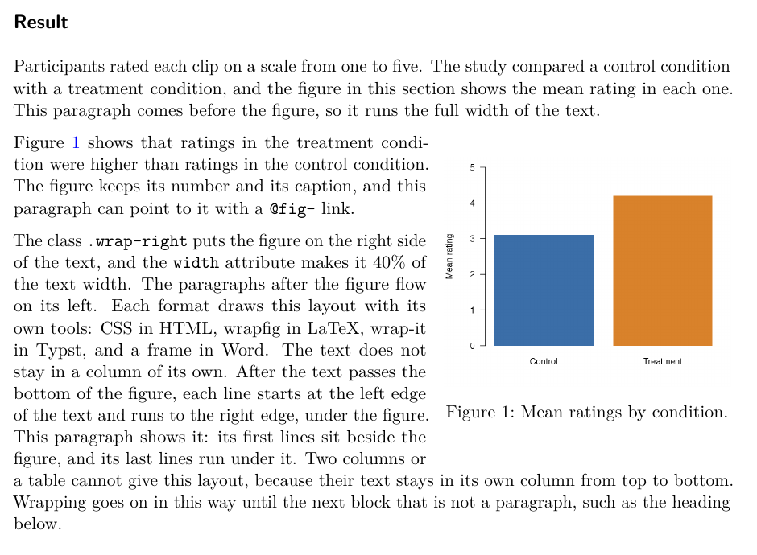

# wrapped

wrapped is a Quarto filter extension. It lets body text flow beside a
figure, to the left or right of it. The figure keeps its number, its
caption, and its `@fig-` links.

This version wraps figures in HTML output, revealjs slides and dashboards
included, in PDF through LaTeX, in PDF through Typst, and in Word. In
every other format, a wrapped figure renders as a normal figure, and the
render prints one warning. A table with a `#tbl-` label wraps in HTML and
in PDF through Typst. In the other formats it keeps its normal layout,
and the render prints a warning.

The documentation is at <https://jmgirard.github.io/wrapped/>.

## Install

The extension asks for Quarto 1.9.36 or later. Each change to it is tested
with Quarto 1.9.36 and with Quarto's current release. In the folder of your project, run:

```bash
quarto add jmgirard/wrapped
```

This command puts the extension under `_extensions/`. Then add the filter
to the document's YAML header:

```yaml
filters:
  - wrapped
```

## Wrap a figure

Add the class `.wrap-right` or `.wrap-left` to a figure. The class names
the side that the figure goes to. The paragraphs after the figure flow
beside it.

```markdown
{#fig-ratings .wrap-right width="40%"}

Participants rated each clip on a scale from one to five. @fig-ratings
shows the mean rating in each condition.
```

The image below is part of the PDF through LaTeX of the example page that
uses this figure. A paragraph runs above the figure, and the next two
paragraphs flow beside it. The last lines of the second one run under the
figure at the full width of the text:

<!-- The end of docs/images/make-images.R gives the commands that make this image. -->


## Learn more

The site covers each part of the extension:

- [Get started](https://jmgirard.github.io/wrapped/get-started.html):
  each way to wrap a figure: a markdown image with or without a caption, a
  div, or a code cell.
- [Width and gap](https://jmgirard.github.io/wrapped/width-gap.html),
  [Document defaults](https://jmgirard.github.io/wrapped/defaults.html),
  and [Where wrapping stops](https://jmgirard.github.io/wrapped/stopping.html).
- [Where a figure keeps its normal layout](https://jmgirard.github.io/wrapped/normal-layout.html).
- One page for each format:
  [HTML, slides, and dashboards](https://jmgirard.github.io/wrapped/formats/html.html),
  [PDF through LaTeX](https://jmgirard.github.io/wrapped/formats/latex.html),
  [PDF through Typst](https://jmgirard.github.io/wrapped/formats/typst.html),
  and [Word](https://jmgirard.github.io/wrapped/formats/word.html).
- [Examples](https://jmgirard.github.io/wrapped/examples/), each with
  its source and its result.
- [Reference](https://jmgirard.github.io/wrapped/reference.html): the
  classes, attributes, and document keys.
