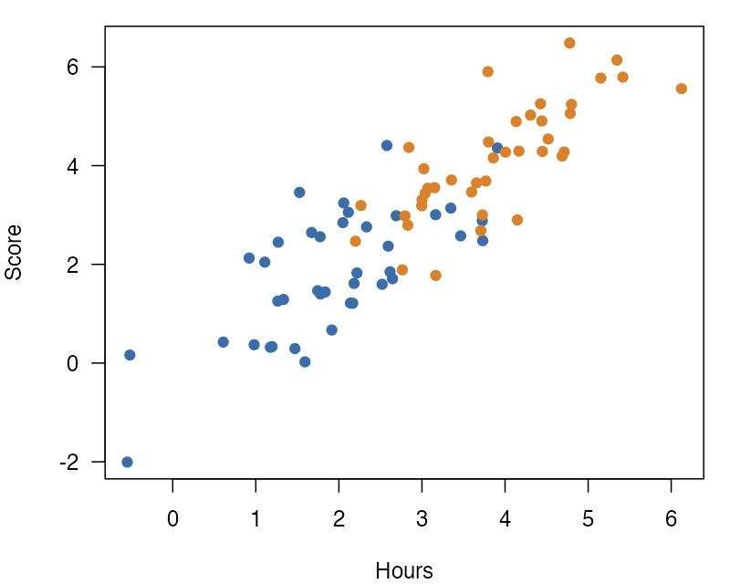

Each figure on this page picks its side with its own class:

```markdown
{#fig-right .wrap-right width="35%"}

...

{#fig-left .wrap-left width="35%"}
```

## Result

This page has two wrapped figures, one on each side of the text. Each
figure picks its side with its own class, and this paragraph comes before
the first one, so it runs the full width of the text.

{#fig-right .wrap-right width="35%"}

@fig-right has the class `.wrap-right`, so it sits on the right, and these
paragraphs flow on its left.

The figure wraps the paragraphs after it until a block that is not a
paragraph. Here that block is the horizontal rule below. The rule starts
below the figure, so the next figure starts on a clear line. In the bar
chart, the mean rating in the treatment condition is higher than in the
control condition. The figure keeps its number, so the text can point to
it, as the paragraph before this one does. Its width of 35% leaves the
rest of the line, less the gap, for the text beside it. The class sets
only the side and the `width` attribute sets only the size, so a change to
one leaves the other as it is. Before the rule, the text of
this paragraph passes the bottom of the figure, and its last lines run
from the left edge of the text to the right edge, under the figure. The text beside the figure and the text under it read as one
paragraph, not as two columns.

* * *

<!-- Keeps the second figure and its text on one page in Typst and Word. In
LaTeX the rule already starts page 2, so a break there would leave a page
with only the rule. HTML has no pages. -->

::: {.content-visible when-format="typst"}

:::

::: {.content-visible when-format="docx"}

:::

The second figure comes after the rule. This paragraph comes before it,
so, like the first paragraph of this section, it runs the full width of
the text.

{#fig-left .wrap-left width="35%"}

@fig-left has the class `.wrap-left`, so it sits on the left, and these
paragraphs flow on its right.

Two wrapped figures right after each other do not both wrap: the first
keeps its normal layout. Put at least one paragraph after each figure, as
this page does. The scatter plot shows each participant's score against
the hours that they practiced, and scores rose with practice in both
groups. Each group has its own color, so the two groups are easy to tell
apart. Like the first figure, this one is 35% of the text width. The
classes `.wrap-left` and `.wrap-right` take the same attributes, so this
figure would move to the right side with a change of its class alone. The
heading after this paragraph stops the second wrap. Before
the heading, the text passes the bottom of the figure, and the last lines
of this paragraph start at the left edge of the text again and run under
the figure.

## Next

A heading is not a paragraph, so wrapping stops before it.
