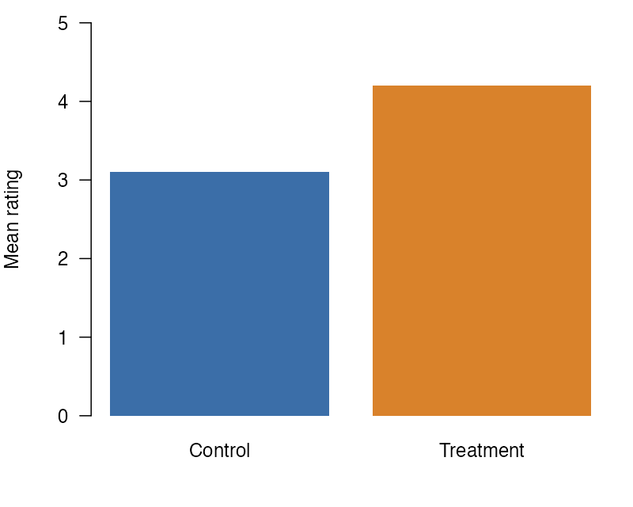

Some places cannot hold a wrapped figure. A wrapped figure there renders as
a normal figure, and the render prints one warning for it.

::: demo
::: callout-note
## A figure in a callout

{#fig-callout .wrap-right width="35%"}

@fig-callout has the class `.wrap-right`, but it is in a callout, so it
keeps its normal layout.
:::
:::

The render of this page prints this warning for @fig-callout:

```
(W) wrapped: the figure #fig-callout is in a callout, so it does not wrap.
```

## Places that keep the normal layout in all four formats

In HTML, PDF through LaTeX, PDF through Typst, and Word, a wrapped figure
in one of the places in this first list does not wrap. It keeps
its normal layout, and the render prints one warning for it. The warning
names the figure's id. If the figure has no id, the warning names its image
file or says that the figure has no id. A code cell that makes more than
one figure gets one warning for the cell instead, as stated below.

- The margin: a figure with the `.column-margin` class, a figure in a
  `.column-margin` or `.aside` div, or a code cell with `#| column: margin`
  or `#| fig-column: margin`. The figure stays in the margin, unless a
  document key comes first in PDF (see the order after this list). In PDF
  through LaTeX, Quarto puts a captioned image that has the
  `.column-margin` class and no `#fig-` id in the body instead. Word has
  no margin column, so there the figure is in the body. This item also
  covers `fig-column: margin` and `column: margin` in the document
  metadata. In HTML and Word, that value applies to every figure with a
  `#fig-` id and every code cell figure, even a cell with
  `#| fig-column: body`. In PDF, the order after this list decides. It
  does not apply to a captioned image with no id, which stays in the body.
  Slides have no margin column, so on a slide only the aside div keeps
  the figure normal (see [Slides](formats/html.qmd#slides)).
- A subfigure panel, such as a figure div with `layout-ncol`, or a
  subfigure inside a panel.
- A panel layout: a div or a code cell with `layout-ncol`, `layout-nrow`,
  or `layout`.
- A list, a definition list included, a callout, a `.columns` layout, or a
  tabset.
- In a dashboard, a code cell that is not inside a `.card` div (see
  [Dashboards](formats/html.qmd#dashboards)).

## When a figure and the document name different places

A figure's own class and the document's `fig-column` or `column` can name
different places. In PDF through LaTeX and PDF through Typst, the
extension reads them in the order of Quarto 1.10.19, and the first one set
decides:

1. the figure's own `fig-column-*` class, such as `.fig-column-margin`,
2. the document's `fig-column`,
3. the figure's own `column-*` or `.aside` class, such as `.column-margin`,
4. the document's `column`.

For a code cell's figure, the document's `fig-column`, else its `column`,
decides over the cell's own `column` or `fig-column` option. If the
document sets `fig-column: body`, a `.column-margin` figure with a `#fig-`
id wraps in PDF, because Quarto puts it in the body there. In HTML,
the extension reads a margin or page-wide class on the figure or its code
cell before the document's key. In Word, it reads a margin class there
first. In HTML and in Word, a body class, such as `.column-body`, does not
override the document's key.

## Code cells with more than one figure

A code cell that makes more than one figure without `fig-subcap` or a
layout option does not wrap either. An example is a cell that draws two
plots. Each of its figures keeps its normal layout, and the render prints one
warning that names the cell's label. The cell can be in a place on this
page where its format keeps the normal layout, such as the margin or a
callout. Then that one warning names the cell and the place, and no warning
names a figure of the cell. If no paragraph follows a cell outside these
places, its figures keep their normal layout with no warning, as any
wrapped figure does there. To wrap a plot, give it its own cell with a
paragraph after it. A cell with `fig-subcap` makes a subfigure panel, and a
cell with `layout-ncol`, `layout-nrow`, or `layout` makes a panel layout.
The list above covers both.

## Tables

A table float does not wrap either, and the render prints one warning that
names it. A `#tbl-` div or a code cell with a `tbl-` label makes a table
float.

## Places that keep the normal layout in some formats

These places keep the normal layout only in the formats named. The render
prints the same warning there, and the figure wraps in the other formats.

- A block quote: in PDF through LaTeX.
- A table cell: in Word and in PDF through LaTeX. In PDF through LaTeX, a
  captioned figure in a table cell fails to render, with or without the
  extension, so only an image with no caption renders there.
- A caption in the margin: in HTML. The extension follows where Quarto
  puts the caption. When the figure or its code cell sets `cap-location`,
  that value decides, and on a code cell `fig-cap-location` acts as
  `cap-location`. Without a `cap-location`, a `margin` value in any of
  three keys sends the caption to the margin: the figure's
  `fig-cap-location`, the document's `fig-cap-location`, and the
  document's `cap-location`. A value other than `margin` in one of these
  three does not override `margin` in another. For a captioned image with
  no id, Quarto reads only the document's `fig-cap-location`, else its
  `cap-location`. The `.margin-caption` and `.caption-margin` classes also
  send the caption to the margin. They work on the figure, on its image,
  and on its code cell, as in `#| classes: wrap-right .caption-margin`. For
  a captioned image with no id, only `.margin-caption` does this.
- A page-wide column: a page-wide class on the figure or on a div around
  it, or a code cell with `#| column: page` or `#| fig-column: page`. The
  classes are `.column-body-outset`, `.column-page-inset`, `.column-page`,
  `.column-screen-inset`, and `.column-screen`, each alone or with `-left`
  or `-right`, and `.column-screen-inset-shaded`. In HTML this covers all
  of them. In PDF through Typst it covers all of them on a div or a code
  cell. For a class on the figure itself, it covers only `.column-page`
  and `.column-screen`, each alone or with `-left` or `-right`. Quarto
  keeps the figure in the body for the others. In PDF through LaTeX
  it covers the classes that Quarto makes page-wide there: those that
  start with `.column-page` or `.column-screen` and do not end in `-left`.
  Word keeps the figure in the body, where it wraps. This item also covers
  a page-wide value of `fig-column` or `column` in the document metadata,
  such as `fig-column: page`. In HTML, that value applies to every figure
  with a `#fig-` id and every code cell figure, even a cell with
  `#| fig-column: body`. In PDF, the order after the first list decides.
  In PDF through Typst it applies as a class on the
  figure itself does, except on a code cell figure. It does not apply to a
  captioned image with no id, which stays in the body.

## Other notes

- A captioned image with no `#fig-` id wraps too, unless a place on this
  page applies to it, such as a caption in the margin. In HTML and Word it
  has no figure number. In PDF through LaTeX and Typst, Quarto numbers it.
- An image beside other content in its paragraph, or in its link, does
  not wrap. In HTML, LaTeX, Typst, and Word the render prints a warning for
  it. An image that is the only content of a link, with the link alone in
  its paragraph, wraps.
- In HTML, LaTeX, and Typst the sides are physical. In a right-to-left
  document, `.wrap-right` still puts the figure on the right. Right-to-left
  Word documents are not tested.
- A long caption wraps inside the figure box.
- If a page has margin content, such as a `.column-margin` note, a figure
  in the body of the page still wraps.
