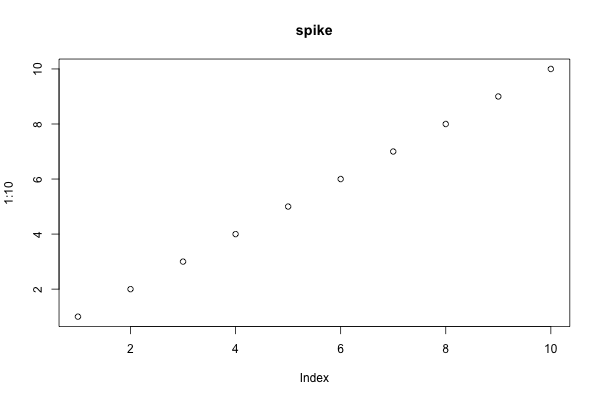

A wrapped figure in a table cell keeps its normal layout in Word, with a
warning. It wraps in HTML and Typst. PDF through LaTeX cannot render a
captioned figure in a table cell, with or without the extension, so this
fixture is not rendered there.

+------------------------------------------------------------+
| Cell                                                       |
+============================================================+
| {#fig-cell .wrap-right}   |
|                                                            |
| The paragraph after the figure in the cell. Lorem ipsum    |
| dolor sit amet, consectetur adipiscing elit.               |
+------------------------------------------------------------+
| {.wrap-left width="20%"}                      |
|                                                            |
| The paragraph after an image with no caption in the cell.  |
| Lorem ipsum dolor sit amet, consectetur adipiscing elit.   |
+------------------------------------------------------------+
